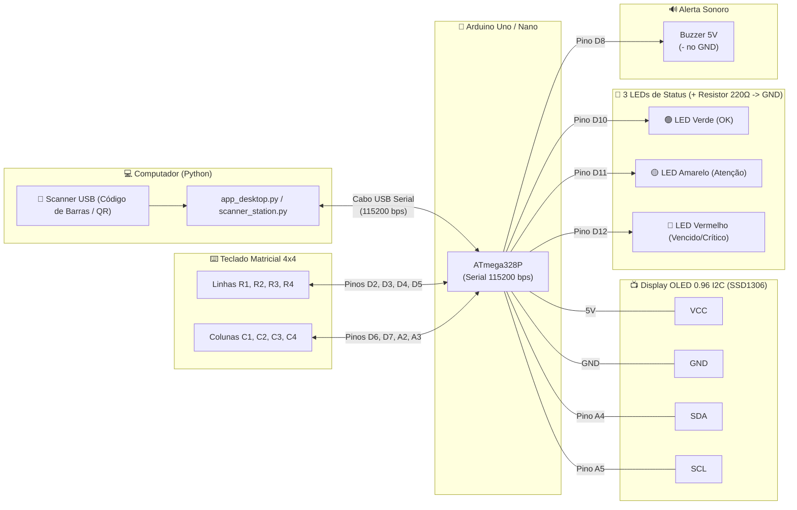

# 💊 Sistema Desktop & IoT de Gestão de Medicamentos, Estoque e Dispensação (FEFO)

Sistema completo para **Farmácia e Enfermaria**, focado no controle de estoque de medicamentos, rastreabilidade de lotes, controle de validade (**FEFO — First Expired, First Out**) e estação de dispensação integrada com **Scanner de Código de Barras/QR Code** e **Arduino / ESP32 (Display OLED 128x64 + Teclado Matricial 4x4 + LEDs de Alerta)**.

Desenvolvido em **Python 3.11+** com interface gráfica nativa (**Tkinter/TTK**), **FastAPI**, **Pydantic** e **SQLAlchemy**, projetado segundo os princípios de **Clean Architecture** e funcionamento **100% offline** (SQLite local por padrão ou PostgreSQL configurável).

---

## ✨ Principais Funcionalidades

- **🖥️ Aplicação Desktop Nativa (`app_desktop.py`):**
  - Operação 100% local/offline sem necessidade de internet.
  - Leitura contínua de **Scanner USB de Código de Barras / QR Code**.
  - Três modos de operação: **Saída / Dispensação FEFO**, **Entrada de Lote / Reposição** e **Consulta Rápida**.
  - **Simulador Visual em Tempo Real:** Exibe na tela do PC exatamente o que aparece no Display OLED 128x64, os 3 LEDs físicos (Verde, Amarelo e Vermelho) e um Teclado Matricial 4x4 clicável.
  - Gestão completa do catálogo de medicamentos, lotes, datas de validade e histórico de movimentações.

- **📦 Controle Rigoroso de Lotes e Validade (FEFO):**
  - Baixa automática priorizando o lote válido que vence primeiro (**First Expired, First Out**).
  - **Bloqueio automático** de dispensação para lotes vencidos.
  - Alertas visuais de lotes próximos do vencimento (≤ 30 dias) e de estoque abaixo do mínimo.

- **🔌 Integração Hardware via Serial (`firmware_oled_medicamentos.ino`):**
  - **Display OLED SSD1306 (128x64 I2C):** Exibe o medicamento, lote, validade e saldo atualizado.
  - **Teclado Matricial 4x4:** Permite digitar quantidades e alternar modos diretamente no hardware (`A`: Saída, `B`: Entrada, `C`: Consulta, `D`: Alertas, `*`: Limpar, `#`: Confirmar).
  - **3 LEDs de Aviso:**
    - 🟢 **Verde:** Lote válido e estoque normal (`OK`).
    - 🟡 **Amarelo:** Atenção — lote próximo do vencimento (≤ 30 dias) ou estoque baixo (`WARN`).
    - 🔴 **Vermelho:** Crítico/Bloqueio — lote vencido ou estoque esgotado (`RED`/`EXPIRED`).

- **🌐 API RESTful & CLI (`main.py` / `manage_medications.py`):**
  - Endpoints FastAPI para integração externa e portal web (`/portal` e `/docs`).
  - Utilitário de linha de comando para gestão rápida e estação de scanner via terminal (`scanner_station.py`).

---

## 🏛️ Arquitetura do Projeto

O projeto organiza suas responsabilidades seguindo a **Clean Architecture**:

- `app_desktop.py`: Interface Gráfica Desktop completa (Tkinter/TTK) com banco local integrado, simulador OLED/LEDs/Teclado 4x4 e comunicação Serial com Arduino.
- `scanner_station.py`: Estação de dispensação e leitura de código de barras via terminal integrada ao Arduino.
- `manage_medications.py`: CLI para cadastro de medicamentos, consulta de saldos, atualização de estoque e auditoria de histórico.
- `firmware_oled_medicamentos.ino`: Código C++/Arduino para o microcontrolador com Display OLED SSD1306, Teclado Matricial 4x4 e LEDs de status.
- `domain/`: Entidades de negócio (`Medication`, `MedicationBatch`, `StockMovement`), regras FEFO, status de validade e contratos de repositório (`IMedicationRepository`).
- `application/`: Casos de uso (`CreateMedicationUseCase`, `UpdateMedicationUseCase`, `DeleteMedicationUseCase`, `ListMedicationsUseCase`, `UpdateStockCommandUseCase`) e DTOs.
- `infrastructure/`: Persistência SQLAlchemy (`SQLite` / `PostgreSQL`), modelos relacionais e repositórios concretos.
- `presentation/`: Servidor FastAPI (`/api/v1/medications`) e Portal Web (`/portal`).

---

## 🚀 Como Executar

### 1. Criar e ativar o ambiente virtual
```bash
python -m venv .venv
# No Windows:
.venv\Scripts\activate
# No Linux/macOS:
source .venv/bin/activate
```

### 2. Instalar as dependências
```bash
pip install --upgrade pip
pip install -r requirements.txt
```

### 3. Iniciar a Aplicação Desktop (Recomendado)
No Windows, basta dar dois cliques em [`iniciar_sistema.bat`](iniciar_sistema.bat) ou executar pelo terminal em qualquer sistema operacional:
```bash
python app_desktop.py
```

### 4. Executar a Estação de Scanner no Terminal (Opcional)
```bash
python scanner_station.py --port COM3
# Ou apenas em modo simulação/consulta sem Arduino conectado:
python scanner_station.py --mode consulta
```

### 5. Executar a API REST (Opcional)
```bash
python main.py
# Ou via Uvicorn:
uvicorn presentation.main:app --reload --host 0.0.0.0 --port 8000
```
- **Swagger UI:** `http://localhost:8000/docs`
- **Portal Web:** `http://localhost:8000/portal`

---

## 💻 Uso via Linha de Comando (CLI)

O utilitário [`manage_medications.py`](manage_medications.py) permite gerenciar medicamentos diretamente pelo terminal:

```bash
# 1. Cadastrar medicamento com estoque inicial:
python manage_medications.py add --name "Dipirona Monoidratada" --dosage "500mg" --stock 100 --min-stock 20 --desc "Analgésico e antitérmico"

# 2. Executar movimentação de estoque (ENTRADA, SAIDA ou AJUSTE):
python manage_medications.py update-stock --name "Dipirona" --quantity 30 --type SAIDA --reason "Dispensação na enfermaria"

# 3. Listar medicamentos e saldos de estoque:
python manage_medications.py list
python manage_medications.py list --low-stock

# 4. Consultar histórico e auditoria de movimentações:
python manage_medications.py history --name "Dipirona"
```

---

## 🌐 Endpoints da API de Medicamentos

- **`POST /api/v1/medications/`**: Cadastra um medicamento (e opcionalmente o lote inicial) registrando a movimentação inicial no histórico:
  ```json
  {
    "name": "Paracetamol",
    "dosage": "750mg",
    "unit": "comprimido",
    "barcode": "7891234560012",
    "initial_stock": 50,
    "minimum_stock": 15,
    "batch_number": "LOTE-2026A",
    "expiration_date": "2027-08-15",
    "description": "Analgésico e antitérmico"
  }
  ```
- **`GET /api/v1/medications/`**: Lista todos os medicamentos com status de estoque (`OK`, `LOW`, `OUT_OF_STOCK`), validade dos lotes e cor de alerta do LED (`GREEN`, `YELLOW`, `RED`).
- **`PUT /api/v1/medications/{id}`**: Atualiza dados cadastrais do medicamento.
- **`DELETE /api/v1/medications/{id}`**: Remove um medicamento e seu histórico.
- **`POST /api/v1/medications/{id}/stock`**: Executa movimentação de estoque (`ENTRADA`, `SAIDA` com baixa FEFO automática ou `AJUSTE`):
  ```json
  {
    "movement_type": "SAIDA",
    "quantity": 5,
    "reason": "Dispensação para paciente"
  }
  ```
- **`GET /api/v1/medications/{id}/movements`**: Retorna o histórico cronológico de movimentações do medicamento.

---

## 🔧 Esquema de Ligação e Diagrama de Montagem (Arduino Uno / Nano)

Firmware principal: [`firmware_oled_medicamentos.ino`](firmware_oled_medicamentos.ino) (Velocidade Serial: `115200 bps`).

### 📦 Lista de Componentes Necessários
| Quantidade | Componente | Função no Sistema |
| :---: | :--- | :--- |
| **1x** | **Arduino Uno R3** (ou Arduino Nano) | Microcontrolador principal via USB (`115200 bps`) |
| **1x** | **Display OLED 0.96" I2C (SSD1306 128x64)** | Exibe medicamento, lote, validade, saldo e modo atual |
| **1x** | **LED Verde (5mm)** + **Resistor 220 Ω** | Indica Lote Válido e Estoque Normal (`OK`) |
| **1x** | **LED Amarelo (5mm)** + **Resistor 220 Ω** | Alerta de Vencimento Próximo (≤ 30 dias) ou Estoque Baixo |
| **1x** | **LED Vermelho (5mm)** + **Resistor 220 Ω** | Alarme Crítico de Lote Vencido (Bloqueado) ou Estoque Zerado |
| **1x** | **Buzzer 5V (Passivo ou Ativo)** | Feedback sonoro de teclas, confirmação e alarme de lote vencido |
| **1x** | **Teclado Matricial 4x4 (Membrana ou Botões)** | Digitação de quantidade e troca rápida de modo (`A`, `B`, `C`, `D`) |
| **1x** | **Protoboard + Jumpers Macho-Macho / Macho-Fêmea** | Montagem das conexões e barramento comum de `5V` e `GND` |

---

### 🗺️ Diagrama de Blocos e Pinagem (Mermaid)



---

### 🔌 Diagrama Visual de Montagem na Protoboard

```text
                       +---------------------------------------+
                       |           ARDUINO UNO / NANO          |
                       |                                       |
   [DISPLAY OLED I2C]  |  [5V]  ------------------------+      |
    +--------------+   |  [GND] ---------------------+  |      |
    |   128 x 64   |   |                             |  |      |
    |  SSD1306     |   |  [A4 (SDA)] -----> SDA      |  |      |
    +--------------+   |  [A5 (SCL)] -----> SCL      |  |      |
      |   |   |   |    |                             |  |      |
     VCC GND SDA SCL   |  [D10] --> [220Ω] --> (🟢 LED VERDE)   --+
      |   |            |  [D11] --> [220Ω] --> (🟡 LED AMARELO) --+--> Barramento GND (-)
      |   +------------+--[D12] --> [220Ω] --> (🔴 LED VERMELHO)--+
      +----------------|--[D8]  -------------> (🔊 BUZZER +)    --+
                       |                                       |
   [TECLADO 4x4]       |  [D2]  <--------- Pino 1 (Linha R1)   |
   +---------------+   |  [D3]  <--------- Pino 2 (Linha R2)   |
   | [1] [2] [3] [A]   |  [D4]  <--------- Pino 3 (Linha R3)   |
   | [4] [5] [6] [B]   |  [D5]  <--------- Pino 4 (Linha R4)   |
   | [7] [8] [9] [C]   |  [D6]  <--------- Pino 5 (Coluna C1)  |
   | [*] [0] [#] [D]   |  [D7]  <--------- Pino 6 (Coluna C2)  |
   +---------------+   |  [A2]  <--------- Pino 7 (Coluna C3)  |
    1 2 3 4 5 6 7 8    |  [A3]  <--------- Pino 8 (Coluna C4)  |
                       +---------------------------------------+
```

---

### 📋 Tabela Completa Pino a Pino (Passo a Passo)

#### 1. Monitor OLED 0.96" SSD1306 (I2C — 4 Pinos)
| Pino do OLED | Pino no Arduino Uno / Nano | Pino no ESP32 | Observação |
| :---: | :---: | :---: | :--- |
| **VCC** | `5V` (ou `3.3V`) | `3V3` | Alimentação do display |
| **GND** | `GND` | `GND` | Terra comum |
| **SDA** | **`A4`** | `GPIO 21` | Dados I2C (endereço `0x3C`) |
| **SCL** | **`A5`** | `GPIO 22` | Clock I2C |

#### 2. LEDs de Status + Buzzer Sonoro
> 💡 **Como ligar os LEDs:** Conecte o pino digital do Arduino na perna mais longa do LED (**Ânodo `+`**), e a perna mais curta (**Cátodo `-`**) em um **resistor de 220 Ω** ligado ao barramento **GND** da protoboard.

| Componente | Pino no Arduino | Comportamento Visual e Sonoro |
| :--- | :---: | :--- |
| 🟢 **LED Verde** | **`D10`** | Acende fixo quando o lote está **válido** e com estoque normal |
| 🟡 **LED Amarelo** | **`D11`** | Acende quando o lote vence em **≤ 30 dias** ou estoque está baixo |
| 🔴 **LED Vermelho** | **`D12`** | **Pisca 3x rápido** e permanece aceso quando o lote está **VENCIDO** ou zerado |
| 🔊 **Buzzer (+)** | **`D8`** | Pino positivo (`+`) no **`D8`** e pino negativo (`-`) no **`GND`**.<br>• **Verde:** 1 bipe agudo curto (`2000 Hz`)<br>• **Amarelo:** 2 bipes médios de alerta (`1200 Hz`)<br>• **Vermelho:** 3 bipes graves de alarme (`650 Hz`) sincronizados com o LED Vermelho<br>• **Teclado:** Clique sonoro a cada tecla pressionada |

#### 3. Teclado Matricial 4x4 (Olhando o teclado de frente, pinos da esquerda para a direita: 1 a 8)
| Pino do Teclado | Função | Pino no Arduino Uno / Nano |
| :---: | :---: | :---: |
| **Pino 1** | Linha 1 (`R1`: teclas `1, 2, 3, A`) | **`D2`** |
| **Pino 2** | Linha 2 (`R2`: teclas `4, 5, 6, B`) | **`D3`** |
| **Pino 3** | Linha 3 (`R3`: teclas `7, 8, 9, C`) | **`D4`** |
| **Pino 4** | Linha 4 (`R4`: teclas `*, 0, #, D`) | **`D5`** |
| **Pino 5** | Coluna 1 (`C1`: teclas `1, 4, 7, *`) | **`D6`** |
| **Pino 6** | Coluna 2 (`C2`: teclas `2, 5, 8, 0`) | **`D7`** |
| **Pino 7** | Coluna 3 (`C3`: teclas `3, 6, 9, #`) | **`A2`** |
| **Pino 8** | Coluna 4 (`C4`: teclas `A, B, C, D`) | **`A3`** |

#### 4. Bibliotecas Necessárias na Arduino IDE
Antes de gravar o arquivo [`firmware_oled_medicamentos.ino`](firmware_oled_medicamentos.ino), instale no **Gerenciador de Bibliotecas** da Arduino IDE (`Sketch` → `Incluir Biblioteca` → `Gerenciar Bibliotecas...`):
1. **Adafruit SSD1306** *(por Adafruit)*
2. **Adafruit GFX Library** *(por Adafruit)*
3. **Keypad** *(por Mark Stanley, Alexander Brevig)*

---

## 🧪 Testes Automatizados

Para rodar a suíte de testes do sistema de medicamentos, estoque e lotes:
```bash
python test_medication_stock.py
```
